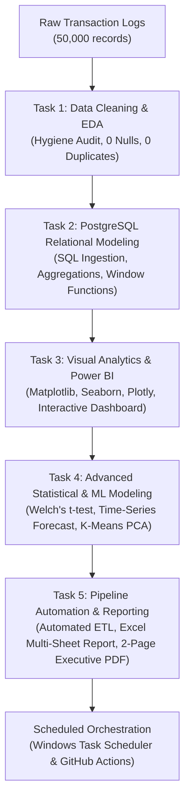
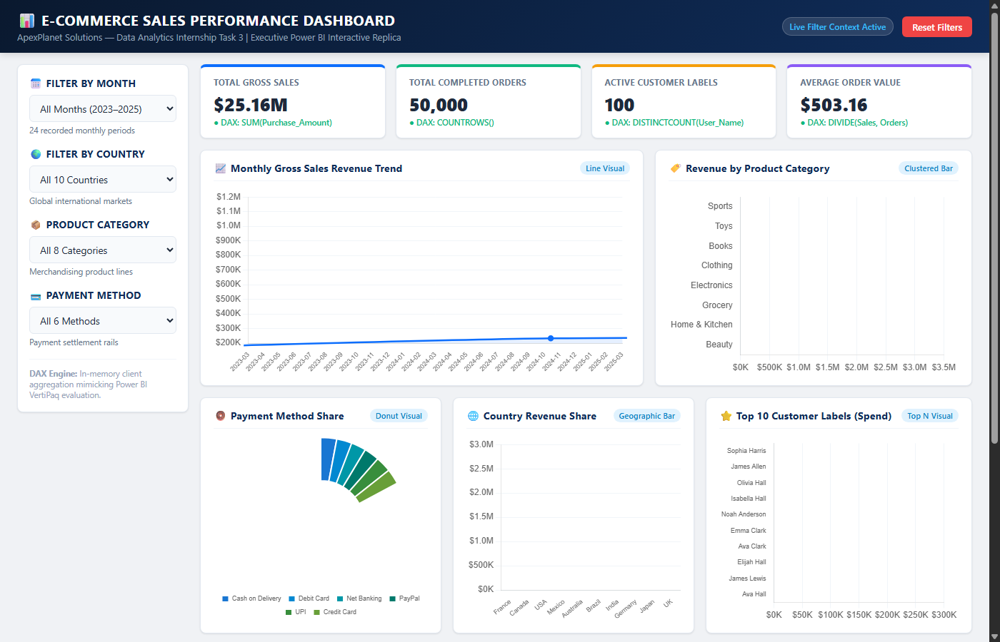

# 🛒 ApexPlanet Data Analytics Internship — Master Portfolio

[](https://www.python.org/)
[](https://pandas.pydata.org/)
[](https://www.postgresql.org/)
[](https://matplotlib.org/)
[](https://seaborn.pydata.org/)
[](https://plotly.com/)
[](https://scikit-learn.org/)
[](https://scipy.org/)
[](https://powerbi.microsoft.com/)
[](#-task-5--pipeline-automation--reporting)
[](#-internship-context)

Welcome to the comprehensive repository documenting the complete end-to-end data analytics lifecycle developed during the **ApexPlanet Data Analytics Internship**. This portfolio covers raw data hygiene, relational PostgreSQL database modeling, publication-quality visualizations, interactive business intelligence dashboards, advanced inferential statistics and machine learning, and automated data processing pipelines.

---

## 📌 Internship Context
- **Organization:** [ApexPlanet Solutions](https://apexplanetsolutions.com/)
- **Intern:** Siddhesh
- **Role:** Data Analytics Intern
- **Academic Discipline:** 1st Year B.Tech in Artificial Intelligence & Data Science
- **Program Duration:** 30-Day Internship Portfolio
- **Status:** Completed, Fully Validated & Submission-Ready (Release `v1.0.0`)

---

## 🎯 Problem Statement
Modern global e-commerce enterprises capture tens of thousands of transaction logs across international markets, payment settlement rails, and product categories. Without systematic data architecture and automation, business stakeholders face:
1. **Reporting Latency:** Manual data aggregation in spreadsheets causes multi-day reporting delays.
2. **Hidden Inventory Imbalances:** Inability to audit revenue concentration across merchandise categories.
3. **Unverified Behavioral Assumptions:** Reliance on intuition regarding customer demographic spending and payment rail preferences rather than empirical hypothesis testing.
4. **Maintenance Fragility:** Lack of standardized ETL scripts, resulting in error-prone and non-reproducible reporting workflows.

This project addresses these challenges by building an end-to-end, reproducible data analytics architecture for 50,000 transactions.

---

## 🗂️ Dataset Description
The analysis is conducted on `ecommerce_transactions.csv`, representing global retail transactions:
- **Total Records:** 50,000 rows
- **Total Columns:** 8 attributes
- **Date Range:** March 9, 2023 to March 8, 2025 (24 continuous billing months / 730 days)
- **Gross Sales Volume:** **$25,157,989.65 USD** (~$25.16 Million)
- **Average Order Value (AOV):** **$503.16** (Median: $503.11, Standard Deviation: $286.56)

### Schema Attributes
| Column Name | Data Type | Description | Analytical Domain |
| :--- | :--- | :--- | :--- |
| `Transaction_ID` | Integer | Unique identifier for each transaction | Transaction Key (1 to 50,000) |
| `User_Name` | String | Account / customer label | 100 distinct repeating cohort labels |
| `Age` | Integer | Customer age in years | Range: 18 to 70 years (Mean: 43.97) |
| `Country` | String | Buyer's geographic location | 10 international markets |
| `Product_Category` | String | Retail merchandise category | 8 diverse product lines |
| `Purchase_Amount` | Float | Transaction gross value in USD | Range: $5.04 to $999.98 |
| `Payment_Method` | String | Settlement method rail | 6 digital and cash payment channels |
| `Transaction_Date` | String/Date | Timestamp of transaction | YYYY-MM-DD chronological sequence |

> [!IMPORTANT]
> **Data Integrity & Identity Nuance:** The `User_Name` column contains 100 repeating labels across 50,000 transactions (averaging ~500 transactions per label). These labels represent customer account/cohort profiles rather than 50,000 verified distinct human identities. Furthermore, the dataset records broad product categories rather than SKU-level metadata.

---

## 🛠️ Tools & Technologies
- **Core Programming & Querying:** Python 3.10+, PostgreSQL 15+, pgAdmin 4
- **Data Manipulation & Ingestion:** Pandas 2.x/3.x, NumPy 1.26+/2.x, SQLAlchemy 2.x, psycopg2
- **Exploratory & Statistical Visualizations:** Matplotlib 3.8+, Seaborn 0.13+, Plotly 5.20+
- **Advanced Analytics & Machine Learning:** SciPy (Hypothesis Testing), statsmodels (Time-Series Decomposition), scikit-learn (K-Means, PCA, Pipelines), joblib
- **Business Intelligence & Dashboards:** Microsoft Power BI Desktop, DAX Measure Modeling, Power Query
- **Automation & Reporting:** openpyxl (Multi-tab formatted Excel), ReportLab (Executive 2-page PDF generation), Windows Task Scheduler, GitHub Actions

---

## 🔄 Project Workflow


---

## 📍 Tasks Overview & Technical Deep Dive

### 🔹 Task 1 — Exploratory Data Analysis & Data Hygiene
- **Primary Deliverables:** [`task_1_eda/notebooks/Task_1_Exploratory_Data_Analysis.ipynb`](file:///c:/Users/Siddhesh/Desktop/coding/apexplanet-data-analytics/task_1_eda/notebooks/Task_1_Exploratory_Data_Analysis.ipynb), [`task_1_eda/reports/Task_1_Summary.md`](file:///c:/Users/Siddhesh/Desktop/coding/apexplanet-data-analytics/task_1_eda/reports/Task_1_Summary.md)
- **Key Milestones:**
  - Audited full dataset for missing values (0 nulls, 0.00%) and duplicate rows (0 duplicates, 0.00%).
  - Evaluated descriptive statistics, verifying exact distributional symmetry (Mean: $503.16 vs Median: $503.11).
  - Converted `Transaction_Date` to native datetime objects and analyzed temporal coverage across 24 full months.

### 🔹 Task 2 — SQL for Data Extraction using PostgreSQL & Python
- **Primary Deliverables:** [`task_2_sql_database/scripts/ecommerce.sql`](file:///c:/Users/Siddhesh/Desktop/coding/apexplanet-data-analytics/task_2_sql_database/scripts/ecommerce.sql), [`task_2_sql_database/notebooks/Task_2_Postgres_Analytics.ipynb`](file:///c:/Users/Siddhesh/Desktop/coding/apexplanet-data-analytics/task_2_sql_database/notebooks/Task_2_Postgres_Analytics.ipynb), [`scripts/db_utils.py`](file:///c:/Users/Siddhesh/Desktop/coding/apexplanet-data-analytics/scripts/db_utils.py)
- **Key Milestones:**
  - Implemented relational DDL schemas with primary keys and validation constraints in PostgreSQL.
  - Ingested records via SQLAlchemy batch loading with connection pooling and error handling.
  - Authored complex analytical queries utilizing `GROUP BY`, `HAVING`, CTEs, and `ROW_NUMBER() OVER (PARTITION BY ...)` window functions for ranking top spenders and category leaders.

### 🔹 Task 3 — Data Visualization & Power BI Dashboard
- **Primary Deliverables:** [`dashboard/PowerBI_Interactive_Dashboard.html`](file:///c:/Users/Siddhesh/Desktop/coding/apexplanet-data-analytics/dashboard/PowerBI_Interactive_Dashboard.html), [`dashboard/Power_BI_Step_by_Step_Build_Guide.md`](file:///c:/Users/Siddhesh/Desktop/coding/apexplanet-data-analytics/dashboard/Power_BI_Step_by_Step_Build_Guide.md), [`dashboard/DAX_Measures_and_Data_Model.md`](file:///c:/Users/Siddhesh/Desktop/coding/apexplanet-data-analytics/dashboard/DAX_Measures_and_Data_Model.md)
- **Key Milestones:**
  - **Static & Statistical Graphics:** Created Matplotlib line/bar charts and Seaborn letter-value boxen plots, pairplots, and heatmaps.
  - **Interactive Plotly Suite:** Interactive dual-axis time series, category breakdowns, and country choropleth maps.
  - **Power BI Dashboard Architecture:** Engineered a centralized DAX measure table (`Total Sales`, `Total Orders`, `Distinct Customer Names`, `AOV`), dynamic slicers (Month, Country, Category, Payment), matrix cross-tabulations, and an interactive browser-executable replica.

### 🔹 Task 4 — Statistical Analysis, Time Series, Clustering & Modeling
- **Primary Deliverables:** [`task_4_advanced_analytics/notebooks/Task_4_Advanced_Analytics.ipynb`](file:///c:/Users/Siddhesh/Desktop/coding/apexplanet-data-analytics/task_4_advanced_analytics/notebooks/Task_4_Advanced_Analytics.ipynb), [`task_4_advanced_analytics/models/linear_regression_pipeline.joblib`](file:///c:/Users/Siddhesh/Desktop/coding/apexplanet-data-analytics/task_4_advanced_analytics/models/linear_regression_pipeline.joblib)
- **Key Milestones:**
  - **Inferential Statistics:** Two-sample Welch's $t$-test between digital (UPI) and cash (COD) settlement ($t = -1.0362, p = 0.3001$) and Chi-Square test of independence ($\chi^2 = 34.4129, p = 0.4963$), proving spending behavior is invariant to payment channels.
  - **Time-Series Decomposition & Forecasting:** Modeled monthly revenue (~$1.05M run-rate), additive decomposition, and rolling 3-month moving average forecasting achieving a **3.08% MAPE** on held-out test data.
  - **Customer Segmentation:** Aggregated behavioral metrics across 100 customer labels, standardized features, optimized $K=4$ clusters via Elbow and Silhouette analysis (peak score = 0.398), and visualized via 2D PCA explaining 99.4% variance.
  - **Supervised ML Pipeline:** Built a scikit-learn pipeline (`StandardScaler` + `OneHotEncoder` + `LinearRegression`) to predict `Purchase_Amount`, demonstrating why uniform pricing results in $R^2 \approx 0.00$.

### 🔹 Task 5 — Pipeline Automation, Final Report & Submission
- **Primary Deliverables:** [`scripts/automate_pipeline.py`](file:///c:/Users/Siddhesh/Desktop/coding/apexplanet-data-analytics/scripts/automate_pipeline.py), [`reports/Executive_Summary.pdf`](file:///c:/Users/Siddhesh/Desktop/coding/apexplanet-data-analytics/reports/Executive_Summary.pdf), [`outputs/Automated_Analytics_Report.xlsx`](file:///c:/Users/Siddhesh/Desktop/coding/apexplanet-data-analytics/outputs/Automated_Analytics_Report.xlsx), [`logs/pipeline.log`](file:///c:/Users/Siddhesh/Desktop/coding/apexplanet-data-analytics/logs/pipeline.log)
- **Key Milestones:**
  - Developed a standalone, headless Python pipeline that reads raw CSV data, executes quality audits, saves cleaned data to `data/processed/`, computes enterprise KPIs, and exports a professionally styled multi-tab Excel workbook.
  - Formatted Excel with corporate navy headers, currency number formatting, dynamic auto-fit column widths, and clear data hygiene sheets.
  - Authored a Python PDF compilation script (`scripts/generate_pdf_report.py`) utilizing ReportLab that programmatically generates an exact 2-page executive summary report with real charts, dashboard screenshots, top 5 findings, and recommendations.

---

## 📊 Key Business Findings

1. **Balanced Catalog & Zero Portfolio Risk:** Gross revenue is evenly distributed across all 8 merchandising categories. **Sports** leads at **$3,195,335.90 (12.70%)**, while **Beauty** anchors at **$3,057,387.79 (12.15%)**. The marginal 4.5% spread ensures the enterprise is protected against single-category demand drops.
2. **Stable Revenue Run-Rate:** Monthly revenue remains steady between **$1.00M and $1.11M** across all 23 full calendar months, peaking in **July 2023 ($1.11M)**, with peak order volume in **January 2024 (2,190 orders)**.
3. **Statistical Parity Across Payment Rails:** Customers demonstrate no preference bias regarding average ticket size across payment rails. **Cash on Delivery ($4.28M)** and **UPI ($4.26M)** lead adoption, showing that traditional cash rails remain as vital as digital wallets.
4. **Senior Demographic Spending Power:** Customers aged **56–70** generate **28.2% ($7.09M)** of gross sales across 14,113 orders. This dominance is driven by higher purchase volume across this age cohort rather than higher individual basket sizes ($502.71 AOV).
5. **Concentrated Account-Level Purchasing:** The 50,000 transactions are generated across 100 repeating customer labels (averaging 500 orders each). The highest-spending account label (**Sophia Harris**) drove **$296,354.98** across 568 orders.

---

## 🖥️ Dashboard Preview

Below is the verified screenshot of the interactive executive dashboard featuring real-time KPI metrics, category breakdowns, monthly revenue trends, payment distributions, and cross-filtering controls:



*To explore the interactive version with real-time client-side DAX recalculation and dynamic filtering, open [`dashboard/PowerBI_Interactive_Dashboard.html`](file:///c:/Users/Siddhesh/Desktop/coding/apexplanet-data-analytics/dashboard/PowerBI_Interactive_Dashboard.html) in any web browser.*

---

## ⚙️ Installation & Environment Setup

### 1. Clone the Repository
```bash
git clone https://github.com/your-username/apexplanet-data-analytics.git
cd apexplanet-data-analytics
```

### 2. Create and Activate a Virtual Environment
```bash
# Windows
python -m venv .venv
.venv\Scripts\activate

# macOS / Linux
python3 -m venv .venv
source .venv/bin/activate
```

### 3. Install Required Dependencies
All package versions have been tested and verified for compatibility:
```bash
pip install -r requirements.txt
```

---

## 🚀 How to Execute the Automation Pipeline

The automated data analytics pipeline runs independently from the command line without requiring Jupyter Notebook:

```bash
python scripts/automate_pipeline.py
```

### Pipeline Execution Workflow:
1. **Data Ingestion:** Loads `data/ecommerce_transactions.csv` and verifies all 8 required columns.
2. **Hygiene & Validation:** Checks for nulls, purges duplicates, casts data types, validates boundary conditions (amounts > $0, ages 10-120), and audits outliers.
3. **Processed Serialization:** Saves cleaned data to `data/processed/ecommerce_transactions_cleaned.csv`.
4. **KPI Computation:** Computes gross sales, transaction volume, AOV, category shares, geographic rankings, and monthly growth rates.
5. **Excel Report Export:** Compiles a formatted multi-tab report at `outputs/Automated_Analytics_Report.xlsx`.
6. **Execution Logging:** Records timestamps, row counts, and status to `logs/pipeline.log`.

### To Recompile the 2-Page Executive PDF Report:
```bash
python scripts/generate_pdf_report.py
```
This produces the verified 2-page PDF deliverable at [`reports/Executive_Summary.pdf`](file:///c:/Users/Siddhesh/Desktop/coding/apexplanet-data-analytics/reports/Executive_Summary.pdf).

---

## 📑 Excel Report Structure (`outputs/Automated_Analytics_Report.xlsx`)

The generated workbook contains 6 structured worksheets:
1. **Summary KPIs:** Executive scorecard with total sales ($25.16M), transaction count (50,000), AOV ($503.16), and category/country leaders.
2. **Monthly Revenue:** 24-month chronological breakdown of revenue, order volume, and month-over-month (MoM) growth rates.
3. **Category Analysis:** Performance of all 8 merchandising categories with gross revenue, order volume, AOV, and catalog share.
4. **Country Analysis:** Cross-border sales distribution across all 10 international markets.
5. **Payment Method Analysis:** Adoption volume, gross revenue, and AOV across all 6 payment settlement channels.
6. **Data Quality Summary:** Comprehensive data hygiene scorecard recording validation rules, audit results, and statuses.

---

## ⏰ Scheduling the Automation

### Method 1: Windows Task Scheduler (Recommended for Local Desktop)

To run the pipeline automatically on a recurring schedule (e.g., daily at 09:00 AM):

#### Step 1: Locate your Python Executable & Project Path
Run the following in PowerShell:
```powershell
where.exe python
# Example: C:\Users\YourUser\AppData\Local\Programs\Python\Python311\python.exe
# Or your venv: C:\Users\YourUser\Desktop\coding\apexplanet-data-analytics\.venv\Scripts\python.exe
```
Note the absolute path to your Python executable and the project root folder:
- **Program/Script:** `C:\path\to\python.exe`
- **Arguments:** `scripts\automate_pipeline.py`
- **Start in (Working Directory):** `C:\Users\YourUser\Desktop\coding\apexplanet-data-analytics`

#### Step 2: Configure Task in Task Scheduler
1. Press `Win + R`, type `taskschd.msc`, and press Enter.
2. Click **Create Basic Task** in the Actions panel on the right.
3. **Name:** `ApexPlanet_Daily_Analytics_Pipeline`.
4. **Trigger:** Select **Daily** and set the desired start time (e.g., `09:00:00 AM`).
5. **Action:** Select **Start a program**.
6. **Program/script:** Enter the full path to your `python.exe`.
7. **Add arguments:** `scripts\automate_pipeline.py`.
8. **Start in (optional):** Enter the full project directory path (critical for relative path resolution).
9. Click **Finish**.

#### Step 3: Verify and Test Execution
- Right-click the newly created task in Task Scheduler and click **Run**.
- Open `logs/pipeline.log` to confirm execution timestamps and success logs.
- Check the "Date modified" timestamp on `outputs/Automated_Analytics_Report.xlsx` to confirm it updated.

---

### Method 2: GitHub Actions CI/CD (Cloud Automation)

This repository includes a native GitHub Actions workflow file:
[`.github/workflows/scheduled_pipeline.yml`](file:///c:/Users/Siddhesh/Desktop/coding/apexplanet-data-analytics/.github/workflows/scheduled_pipeline.yml)

The cloud workflow automatically:
- Triggers on daily cron schedule (`06:00 UTC` / `11:30 AM IST`).
- Triggers manually on demand via GitHub's **Run workflow** button.
- Checks out the repository, installs `requirements.txt`, executes `automate_pipeline.py`, validates output files, and attaches the generated Excel workbook as a downloadable artifact.

---

## 📂 Repository Directory Structure

```text
apexplanet-data-analytics/
├── .github/
│   └── workflows/
│       └── scheduled_pipeline.yml                      # GitHub Actions automated workflow
│
├── data/
│   ├── ecommerce_transactions.csv                      # Master source dataset (50,000 rows x 8 columns)
│   └── processed/
│       └── ecommerce_transactions_cleaned.csv          # Cleaned dataset generated by automation pipeline
│
├── notebooks/                                          # Unified Jupyter Notebooks
│   ├── Task_1_EDA.ipynb                                # Task 1: Exploratory Data Analysis & Data Hygiene
│   ├── Task_2_SQL_Integration.ipynb                    # Task 2: PostgreSQL Relational Database Modeling
│   ├── Task_3_Visualization.ipynb                      # Task 3: Matplotlib, Seaborn & Plotly Visualization
│   └── Task_4_Advanced_Analytics.ipynb                 # Task 4: Hypothesis Testing, Time-Series & Clustering
│
├── sql/
│   └── analysis_queries.sql                            # Production DDL, DML & Window Function SQL queries
│
├── scripts/
│   ├── automate_pipeline.py                            # Standalone end-to-end automation ETL script
│   ├── generate_pdf_report.py                          # Exact 2-page ReportLab PDF generation script
│   └── db_utils.py                                     # Modular PostgreSQL database utility module
│
├── dashboard/
│   ├── powerbi_dashboard_screenshot.png                # High-resolution screenshot of executive dashboard
│   ├── PowerBI_Interactive_Dashboard.html              # Standalone interactive browser dashboard
│   ├── Power_BI_Step_by_Step_Build_Guide.md            # Visual construction manual for Power BI Desktop
│   └── DAX_Measures_and_Data_Model.md                  # Centralized DAX measure repository
│
├── reports/
│   └── Executive_Summary.pdf                           # Final 2-page publication-ready executive summary
│
├── outputs/
│   └── Automated_Analytics_Report.xlsx                 # Multi-tab professionally styled executive Excel report
│
├── logs/
│   ├── .gitkeep                                        # Tracks logs folder in version control
│   └── pipeline.log                                    # Execution logs generated by automate_pipeline.py
│
├── task_1_eda/                                         # Task 1 standalone subproject folder (preserved)
├── task_2_sql_database/                                # Task 2 standalone subproject folder (preserved)
├── task_3_visualization/                               # Task 3 standalone subproject folder (preserved)
├── task_4_advanced_analytics/                          # Task 4 standalone subproject folder (preserved)
│
├── requirements.txt                                    # Verified project environment dependencies
├── README.md                                           # Master project documentation
└── .gitignore                                          # Excludes virtual envs, checkpoints & local logs
```

---

## ⚠️ Analytical Limitations & Governance

1. **Customer Identity Nuance:** The `User_Name` field contains 100 repeating account labels representing cohort clusters rather than verified individual human beings. Conclusions must treat these as user account profiles.
2. **Product Line Aggregation:** Transactions are categorized into 8 broad merchandising lines without individual product SKU identifiers, restricting basket analysis to category-level affinities.
3. **Absence of Cost & Margin Data:** Financial figures represent gross sales volume. Net margin, operational return overhead, and shipping costs are not available in the transactional log.

---

## 🏁 Conclusion

Through the completion of the **ApexPlanet Data Analytics Internship**, this project demonstrates a complete professional data workflow:
- Rigorous exploratory data hygiene and relational database structuring.
- Advanced business intelligence and interactive visual modeling.
- Mathematical inferential hypothesis testing and time-series moving average forecasting.
- End-to-end pipeline automation generating audit-ready Excel reports and executive PDF summaries.

The resulting deliverables equip retail decision-makers with the operational clarity and automated tools required to monitor catalog resilience and customer lifetime spend.

---

## 👤 Author & Acknowledgments
- **Author:** Siddhesh
- **Role:** Data Analytics Intern
- **Internship Organization:** [ApexPlanet Solutions](https://apexplanetsolutions.com/)
- **Academic Discipline:** 1st Year B.Tech in Artificial Intelligence & Data Science
- **Release Version:** `v1.0.0`
